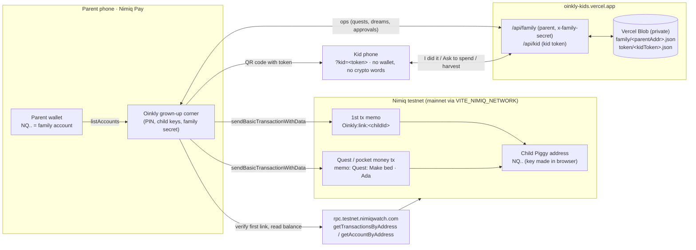

# Oinkly architecture

Oinkly separates **who the family is** (the parent's Nimiq address), **where a child's money lives** (the child's own Piggy address), **who a Piggy belongs to** (an on-chain link payment), and **what the kid's phone may see** (a per-child secret token).



## Identity
1. **Parent connect.** Inside Nimiq Pay, `listAccounts()` returns the parent's address. It is the family key: all data is stored under `family/<parentAddress>`, so two parents can never collide.
2. **Add child.** Name + animal avatar, then **Create Piggy** generates an Ed25519 keypair in the browser (`@noble/curves` + Blake2b, the same derivation as Nimiq; cross-checked against `@nimiq/core`). The parent can instead paste an existing Nimiq address.
3. **On-chain link.** The parent sends 1 NIM to the Piggy with memo `Oinkly:link:<childId>`. The app reads the Piggy's history from the RPC and accepts the link only if the **earliest** `Oinkly:link:` payment to that address came **from this parent** and names **this child**. Any later link from another parent is ignored, so one child has exactly one parent, while one parent can link many children.
4. **Kid device.** "Kid's phone" shows a QR/link `https://oinkly-kids.vercel.app/?kid=<token>` (24 random chars). The kid's phone remembers it and only ever receives that child's view: no address, no key, no token for siblings.
4b. **Kid key login.** "Kid's login key" shows `/#key=<privateKey>` as a QR (the `#` part never reaches the server). The kid's phone signs `Oinkly login <timestamp>` with the key and posts `{pub, sig, ts}` to `/api/login`, which checks the Ed25519 signature, derives the Piggy address, finds the child through `jar/<address>`, and returns that child's token. The key stays only on the kid's phone.
4c. **Break the bank.** With the key, the kid's phone builds and signs a payment of the whole Piggy balance in the browser (same bytes as `@nimiq/core`, `src/keys.ts`), sends it with `sendRawTransaction`, then reports `{op: 'broke', tx}` so the coin count resets and the parent's log shows it. Memo: `Oinkly: <child> broke the bank for <what>`.
5. **Payments.** Quest approvals send `coins × 10` NIM with memo `Quest: <title> · <child>`; pocket money uses `Pocket money · <child>`. Pay buttons stay disabled until the Piggy is linked.

## Data model (`src/model.ts`)
```
Family { parent: NQ.., kids: Kid[], log: string[], updated }
Kid    { id, name, avatar, jar: NQ.., custody: 'app-key'|'pasted', token, linked, linkTx,
         coins, seeds, lastBonus, lessons[], dream{title,emoji,coins}, quests[], spends[] }
Quest  { id, title, emoji, coins, status: open|done|paid, tx? }
Spend  { id, what, coins, need, status: asked|ok|no }
```
Stored server-side as `family/<parent>.json = { secretHash, family }`, `token/<kidToken>.json = { parent, kidId }` and `jar/<piggyAddress>.json = { parent, kidId }`.
Kept **only on the parent phone** (localStorage): child private keys, the PIN, and the family secret.

## Sync and conflict rules
- Clients never upload whole state. They send small **operations** (`addQuest`, `paidQuest`, `questDone`, `ask`, ...), and the server applies them to the latest stored family using the same reducer the client uses for optimistic updates.
- Parent ops need `x-family-secret`. The first device to write a family claims it; other devices need the **family recovery code** (shown in Settings).
- Kid ops are limited to `questDone` (open→done only), `ask` (max 5 pending), `harvest` (once per week), and `broke` (once per tx hash; resets coins and seeds).
- Operations are idempotent where it matters: a quest can only be paid once, and a spend decided once.
- A Piggy address can't be added twice in a family, can't be the parent's own address, and a kid token can't be claimed by another family.
- Ownership of a Piggy is decided by the chain (first link payment), not by the database.
- Clients poll (kid every 10 s, parent every 15 s). Two ops landing in the same instant could race (last write wins); this is acceptable for a family-sized app.

## Security and custody (honest notes)
- **Created Piggies are custodied by the parent's phone.** The private key sits unencrypted in that browser's localStorage. If the app data is cleared, the key is gone unless the parent backed it up (Settings → Back up Piggy key). Use a pasted Nimiq Pay address for larger amounts.
- A kid who logs in with the Piggy key can spend the whole Piggy (break the bank) without asking. The key then also lives in the kid's browser storage; logging out (🚪) removes it.
- The family secret is a bearer token, not a wallet signature. Nimiq Pay's mini-app SDK currently has no message-signing call, so the server cannot prove the caller owns the parent address. Anyone who knows a parent address could claim an *empty* family record first; the on-chain link still can't be faked.
- The kid token is a bearer link: anyone with it sees that child's piggy and can tap "I did it" or ask to spend, but cannot move money.
- The PIN is a local lock, not encryption.

## Limits
- Coins in the app are counted from approved payments; they are not reconciled against the on-chain balance.
- Patience Seeds are app points, not on-chain interest. Approving a spend moves no NIM.
- RPC reads use the public, rate-limited nimiqwatch RPC (`rpc.testnet.nimiqwatch.com`, or `rpc.nimiqwatch.com` on mainnet); the balance and link check show an error and can be retried.
- Not yet tested inside a real Nimiq Pay wallet.
- Storage: Vercel Blob (private store `oinkly-sync`). Without `BLOB_READ_WRITE_TOKEN` the API falls back to in-memory storage (demo only, lost on cold start). Swap `api/_store.ts` for any key-value store.
